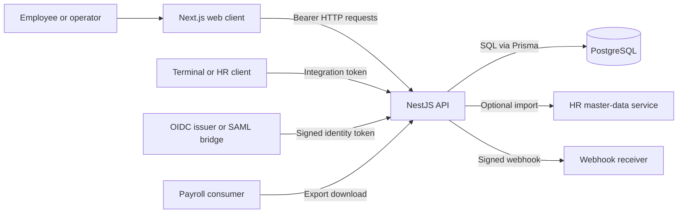
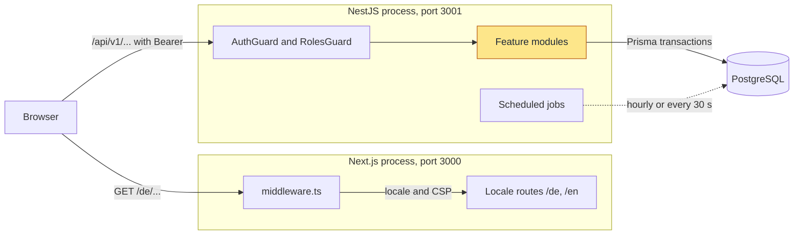
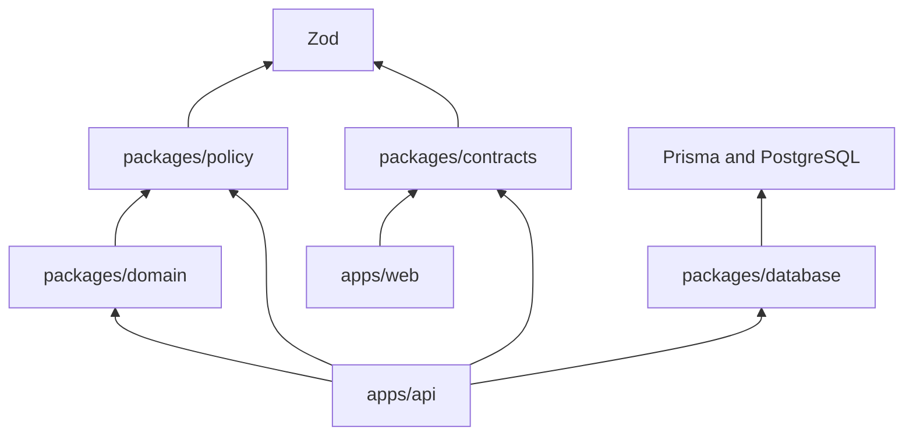
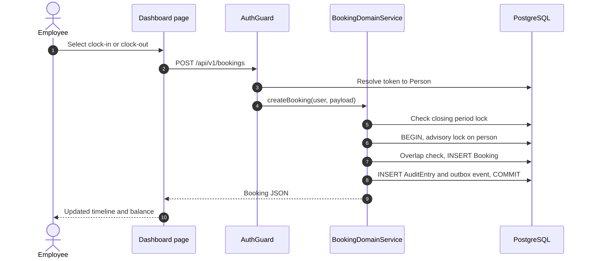
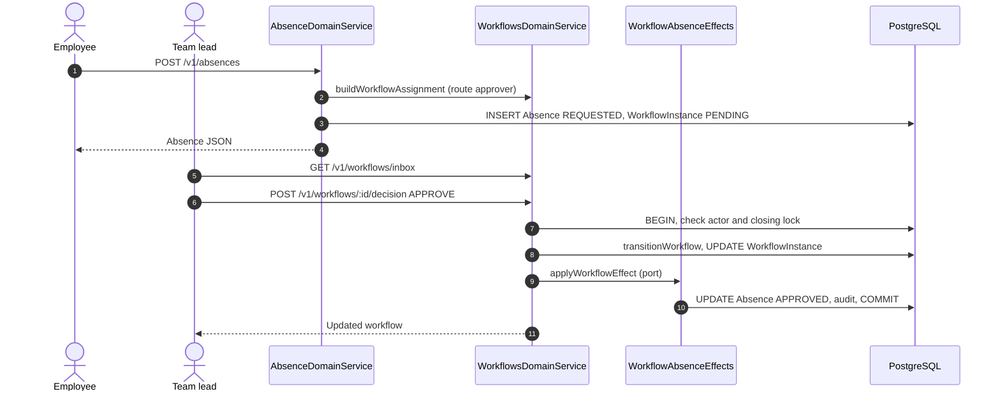
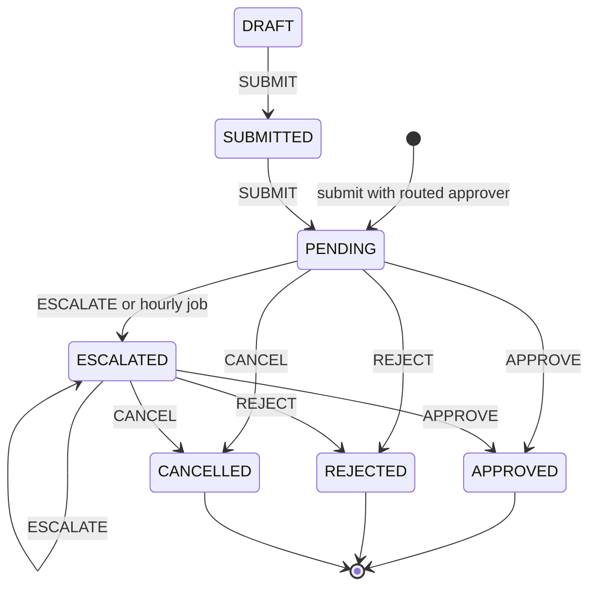
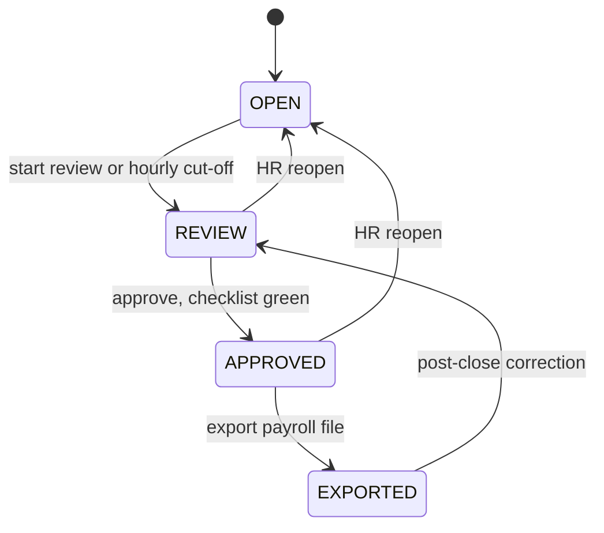
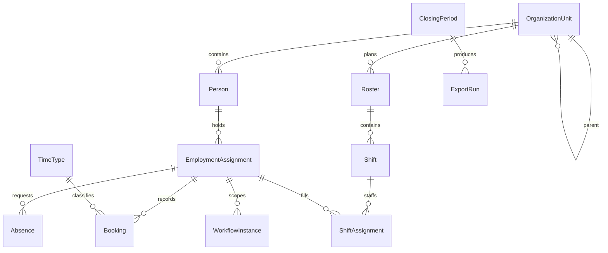
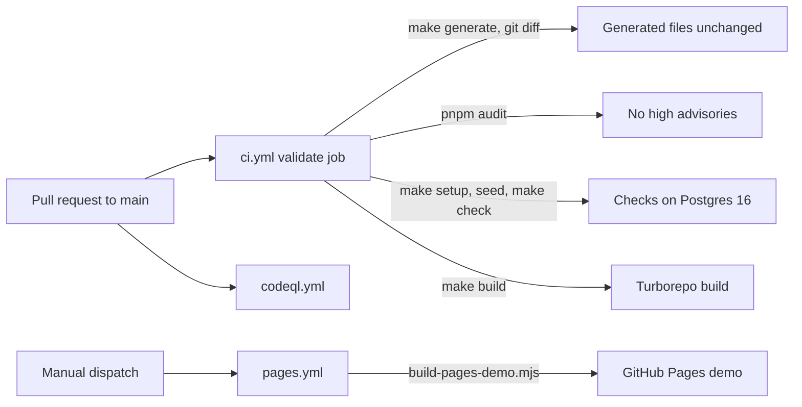

# Architecture

cueq is a TypeScript modular monolith for time recording, absence management,
shift planning, and related university HR work. The repository contains two
runtime applications, a Next.js web client and a NestJS API, plus shared
packages for contracts, policy, domain rules, and PostgreSQL access.

The API is the security and transaction boundary. The web client may hide or
show navigation based on the signed-in role, but every operation is authorized
again by the API.

## System overview



Identity providers, physical terminals, HR systems, payroll consumers, webhook
receivers, TLS termination, and network controls are supplied by the deployment
environment. The static GitHub Pages demo under `docs/demo` uses deterministic
browser data and does not connect to the application.

## How it runs

This diagram shows which processes run during local development and how they
connect.



`make dev` starts both processes on the host. Docker Compose starts only
PostgreSQL, published at `127.0.0.1:5433`. The browser always sends API calls
to the same origin under `/api`. `next.config.ts` rewrites `/api/:path*` to
`http://localhost:3001/:path*`, so the API sees `/v1/...` paths. The bearer
token is held in React state by `ApiProvider` and is not persisted; only the
API base URL is kept in `sessionStorage`. Users choose a token on the settings
page. In development these are mock identities; OIDC or a SAML bridge supply
real ones.

Background work runs inside the API process through `@nestjs/schedule`. There
is no separate worker or queue:

| Job                         | Schedule      | Effect                                                 |
| --------------------------- | ------------- | ------------------------------------------------------ |
| `WorkflowEscalationService` | hourly        | Escalates overdue `PENDING` or `ESCALATED` workflows   |
| `ClosingCutoffService`      | hourly        | Moves `OPEN` closing periods past cut-off to `REVIEW`  |
| `WebhookJobWorkerService`   | startup, 30 s | Resumes webhook dispatch jobs an administrator started |
| `DocumentRecoveryService`   | 30 s          | Resolves staged document uploads after interruptions   |
| `DocumentRemindersService`  | 30 s          | Creates in-app reminders for expiring documents        |
| `LifecycleRemindersService` | startup, 30 s | Creates in-app reminders for due lifecycle tasks       |
| `LifecycleAutomationWorker` | startup, 30 s | Runs lifecycle automation rules                        |

Where in the code:

- [apps/api/src/main.ts](apps/api/src/main.ts): API bootstrap, body limits,
  Helmet, CORS, exception filters, Swagger in development.
- [apps/api/src/app.module.ts](apps/api/src/app.module.ts): module composition
  and `ScheduleModule`.
- [apps/api/src/platform/auth/guards/auth.guard.ts](apps/api/src/platform/auth/guards/auth.guard.ts):
  bearer verification and person resolution.
- [apps/web/next.config.ts](apps/web/next.config.ts): `/api` rewrite and
  security headers.
- [apps/web/src/middleware.ts](apps/web/src/middleware.ts): locale routing and
  the per-request content security policy.
- [apps/web/src/platform/http/api-context.tsx](apps/web/src/platform/http/api-context.tsx):
  token and API base URL state.
- [docker-compose.yml](docker-compose.yml): local PostgreSQL.

## Repository layers

The runtime code is split by responsibility:

- `apps/web` contains locale-aware routes, browser preferences, shared UI, and
  the HTTP client.
- `apps/api` contains authentication, authorization, transactions, scheduled
  work, and the application features.
- `packages/contracts` defines Zod request, response, and event schemas shared
  by the applications.
- `packages/policy` contains versioned workforce policies.
- `packages/domain` contains pure calculations and state machines for time,
  absence, rosters, workflows, closing, and audit behavior.
- `packages/database` owns the Prisma schema, migrations, client, seed data,
  imports, document storage, and recovery tools.
- `schemas/domain` contains the JSON Schemas used to generate the domain schema
  index and TypeScript bindings.

The shared packages are private workspace dependencies. PostgreSQL is required
to run the API; the repository's Compose file starts only a local PostgreSQL
instance.

Dependencies point inward:



`packages/domain` must not depend on NestJS, Prisma, HTTP, browser, filesystem,
or process APIs. Contracts and policy depend on Zod but no other workspace
package. The database package handles persistence rather than domain or HTTP
orchestration. `scripts/check-architecture.mjs` checks these rules, package and
feature cycles, retired paths, public feature imports, and selected ownership
boundaries.

## API modules

`apps/api/src/app.module.ts` is the composition root. Authentication, HTTP
policy, validation, and transactions live under `apps/api/src/platform`;
Prisma lifecycle code lives under `apps/api/src/persistence`.

Application features live under `apps/api/src/modules`:

```text
absence       attendance    audit          closing       documents
integrations  lifecycle     people         policy        projects
reporting     scheduling    session        workflows
```

A feature owns its controllers, application services, and internal helpers.
Another feature imports from its `public.ts` file instead of reaching into its
internals. Writes to an aggregate owned by another feature go through a narrow
application port implemented by that owner.

The workflows feature decides and coordinates effects on absences, bookings,
and rosters through those ports. Absence and closing use the smaller
`modules/workflows/workflow-runtime.public.ts` API for assignments and state
queries. This keeps the NestJS module graph acyclic without `forwardRef`.
Reporting and integrations expose data or protocols but do not take ownership
of the underlying business records.

## User journeys

### Record a booking

This diagram shows what happens when an employee selects clock-in or clock-out
on the dashboard.



The guard (3) verifies the token with the configured identity provider and maps
it to a local `Person`. `ZodValidationPipe` checks the body against
`CreateBookingSchema` before the service runs. The service then checks that
the user may act for the target person. Steps 6–8 run in one Prisma
transaction: the closing lock is checked again, a transaction-scoped advisory
lock serializes writes for that person, and the `booking.created` outbox row is
committed together with the booking and its audit entry. If the month is
locked for closing, the request fails with 409 `CLOSING_PERIOD_LOCKED` and an
audit entry records the blocked attempt.

Where in the code:

- [apps/web/src/app/[locale]/dashboard/use-dashboard-workspace.ts](apps/web/src/app/[locale]/dashboard/use-dashboard-workspace.ts)
- [apps/api/src/modules/attendance/bookings.controller.ts](apps/api/src/modules/attendance/bookings.controller.ts)
- [apps/api/src/modules/attendance/booking-domain.service.ts](apps/api/src/modules/attendance/booking-domain.service.ts)
- [apps/api/src/modules/attendance/booking-create.writer.ts](apps/api/src/modules/attendance/booking-create.writer.ts)
- [apps/api/src/platform/transactions/closing-lock.helper.ts](apps/api/src/platform/transactions/closing-lock.helper.ts)
  and [transaction-lock.helper.ts](apps/api/src/platform/transactions/transaction-lock.helper.ts)

### Request and approve leave

This diagram shows how a leave request reaches an approver and how the
approval changes the absence. The workflows feature never writes the absence
itself.



Absence types that need approval get a `LEAVE_REQUEST` workflow in the same
transaction as the absence (3). The approver comes from the requester's
supervisor, delegation rules, and the workflow policy (2). The decision (6–10)
is one transaction. The actor is authorized before closing guards run, so a
non-approver gets 403 rather than 409. The state change uses the pure
`transitionWorkflow` from `packages/domain` (8). The effect on the absence (9)
goes through `ABSENCE_WORKFLOW_EFFECTS_PORT`, which the absence feature
implements. Booking corrections, shift swaps, and overtime approvals use the
same decision path with the attendance and scheduling ports.

Where in the code:

- [apps/web/src/app/[locale]/leave/page.tsx](apps/web/src/app/[locale]/leave/page.tsx)
  and [approvals/use-approvals-workspace.ts](apps/web/src/app/[locale]/approvals/use-approvals-workspace.ts)
- [apps/api/src/modules/absence/absence-create.writer.ts](apps/api/src/modules/absence/absence-create.writer.ts)
- [apps/api/src/modules/workflows/workflow-domain-decision.ts](apps/api/src/modules/workflows/workflow-domain-decision.ts)
- [apps/api/src/modules/workflows/workflow-side-effects.helper.ts](apps/api/src/modules/workflows/workflow-side-effects.helper.ts)
- [apps/api/src/application/ports/workflow-side-effects.port.ts](apps/api/src/application/ports/workflow-side-effects.port.ts)
- [apps/api/src/modules/absence/workflow-absence-effects.service.ts](apps/api/src/modules/absence/workflow-absence-effects.service.ts)

### Other flows

Some flows add more coordination:

- attendance, absence, and scheduling writes may also create workflow, audit,
  or outbox records in the same feature-owned transaction;
- workflow decisions call feature-owned ports to apply their effects;
- workflow escalation and closing cut-off scans run hourly in the API process;
- an administrator starts a finite webhook dispatch, while startup recovery and
  30-second polling resume existing jobs without creating new ones;
- terminal batches use a separate integration token and apply locking,
  ordering, and idempotency checks;
- HR data can arrive through the token-protected API, a configured HTTP
  provider, or the database package's CSV command; and
- closing creates payroll export artifacts that authorized clients download
  through the API.

## Approval and closing states

Workflows and closing periods are the two state machines that most other
features check before they write. Both are pure functions in `packages/domain`;
the API persists the result.

This diagram shows the states a request such as leave, a booking correction, a
shift swap, or overtime goes through:



The API creates workflows directly in `PENDING` after routing the approver.
`DRAFT` and `SUBMITTED` exist in the state machine, and `CANCEL` is also allowed
from them. `DELEGATE` changes the approver without changing the state.
`APPROVED`, `REJECTED`, and `CANCELLED` are final.

This diagram shows the states of a monthly closing period, for one
organization unit or for all units:



An administrator starts review by hand, or the hourly cut-off job does it.
Team leads add a lead approval during review. HR or an administrator approves
once no checklist item is in error, then exports, reopens, or starts a
post-close correction. Bookings, absences, and workflow decisions that overlap
a locked period are rejected. The database stores `APPROVED` as
`ClosingStatus.CLOSED`, and `closing-mapping.ts` converts between the two. An
export creates an `ExportRun` with a checksum, which payroll consumers download
through the API.

Where in the code:

- [packages/domain/src/workflow/index.ts](packages/domain/src/workflow/index.ts):
  `transitionWorkflow`, `shouldEscalate`.
- [packages/domain/src/closing/transitions.ts](packages/domain/src/closing/transitions.ts):
  closing transitions and role checks.
- [apps/api/src/modules/closing/closing.controller.ts](apps/api/src/modules/closing/closing.controller.ts)
  and [closing-mapping.ts](apps/api/src/modules/closing/closing-mapping.ts).
- [apps/api/src/modules/closing/closing-cutoff.service.ts](apps/api/src/modules/closing/closing-cutoff.service.ts)
  and [workflows/workflow-escalation.service.ts](apps/api/src/modules/workflows/workflow-escalation.service.ts):
  hourly jobs.

## Contracts and data

NestJS controllers and Swagger decorators define the HTTP API. The generated
snapshot at `contracts/openapi/openapi.json` is the committed review artifact,
while `packages/contracts` supplies runtime Zod validation. Swagger UI is
available at `/api/docs` outside production and disabled in production.

Prisma models and migrations live under `packages/database/prisma`. They cover
people, employment appointments, organization units, bookings, absences,
rosters, workflows, closing periods, time accounts, audit entries, outbox
events, webhook attempts, terminal health, HR imports, projects, lifecycle
plans, private-document metadata, and export artifacts. Encrypted document
objects use the database package's filesystem adapter. See the
[university HR guide](docs/UNIVERSITY-HR.md) for the appointment and personnel
model.

The Prisma schema has more than 50 models. This diagram shows only the core
that time recording, leave, rosters, and closing share:



`EmploymentAssignment` is the appointment that bookings, absences, time
accounts, and shift assignments belong to. A person can hold several
appointments. `WorkflowInstance` points to the record it decides through
`entityType` and `entityId` (for example `Absence`), not through a foreign key.
`ClosingPeriod` stores an optional `organizationUnitId` without a relation;
`null` means the period covers all units. `AuditEntry` and `DomainEventOutbox`
have no foreign keys and can reference any record.

Related writes use Prisma transactions when state, audit, or outbox updates
must be atomic. A committed database trigger rejects `UPDATE` and `DELETE` on
audit rows. It does not provide cryptographic tamper evidence or protect against
a privileged database administrator or `TRUNCATE`.

## Generated files

`make generate` produces three committed files:

- `contracts/openapi/openapi.json` from the built NestJS application;
- `docs/generated/db-schema.md` from the JSON Schemas in `schemas/domain`; and
- `packages/domain/src/generated/schema-contracts.ts` from the same schemas.

Despite its name, `docs/generated/db-schema.md` indexes domain JSON Schemas; it
is not a rendering of the Prisma schema. Change the owning source and regenerate
these files instead of editing them directly.

## Build, CI, and deployment

This diagram shows what runs on a pull request and how the browser demo is
published:



`ci.yml` runs on pull requests to `main` and on manual dispatch. When a pull
request changes only the README or demo files, it builds and verifies the demo
instead of running the full validation. The fresh-clone smoke job runs only on
manual dispatch or Dependabot pull requests.
CodeQL also runs on pushes to `main` and on alpha tags. The Pages demo is
published only by manual dispatch. No workflow deploys the API or web
application.

Where in the code:

- [.github/workflows/ci.yml](.github/workflows/ci.yml),
  [codeql.yml](.github/workflows/codeql.yml),
  [pages.yml](.github/workflows/pages.yml)
- [Makefile](Makefile) and [scripts/check.sh](scripts/check.sh): local and CI
  check targets.
- [turbo.json](turbo.json): task graph for build, lint, typecheck, and test.

Turborepo builds shared packages before the applications. The production start
commands run built API and web output, but they do not migrate the database,
terminate TLS, supervise processes, or roll back a release. The API reads its
environment from the process; the web application follows Next.js environment
file handling.

This repository has no application Dockerfile, published image, production
topology, secret manager, monitoring stack, alert delivery, or backup-retention
policy. [Operations](docs/OPERATIONS.md) and [Security](docs/SECURITY.md) list
what a deployment must provide. [ADR-002](docs/design-decisions/002-deployment-strategy.md)
records why deployment infrastructure remains outside this repository.

## Code map

Read the code in this order:

| Path                                                                             | Responsibility                                                |
| -------------------------------------------------------------------------------- | ------------------------------------------------------------- |
| [apps/api/src/main.ts](apps/api/src/main.ts)                                     | API process bootstrap                                         |
| [apps/api/src/app.module.ts](apps/api/src/app.module.ts)                         | Lists every feature module                                    |
| [apps/api/src/platform](apps/api/src/platform)                                   | Auth guards, HTTP validation and filters, transaction locks   |
| [apps/api/src/modules](apps/api/src/modules)                                     | One folder per feature; start with `attendance` and `absence` |
| [apps/api/src/application/ports](apps/api/src/application/ports)                 | Cross-feature ports such as workflow effects                  |
| [packages/domain/src](packages/domain/src)                                       | Pure time, leave, roster, workflow, and closing rules         |
| [packages/policy](packages/policy)                                               | Versioned working-time and leave policies                     |
| [packages/contracts](packages/contracts)                                         | Zod schemas used by the API and the web client                |
| [packages/database/prisma/schema.prisma](packages/database/prisma/schema.prisma) | Prisma data model; migrations live next to it                 |
| [apps/web/src/app/[locale]](apps/web/src/app/[locale])                           | One folder per screen, such as `dashboard` and `approvals`    |
| [apps/web/src/platform/http](apps/web/src/platform/http)                         | Browser API client and token context                          |
| [scripts/check-architecture.mjs](scripts/check-architecture.mjs)                 | Enforces the dependency and feature boundaries above          |

## Making architectural changes

- Put new API behavior in the feature that owns the affected records.
- Expose deliberate cross-feature APIs through `public.ts` or an application
  port.
- Put deterministic calculations in `packages/domain` and data-driven rules in
  `packages/policy`.
- Add HTTP and event shapes to `packages/contracts`, then regenerate and review
  OpenAPI.
- Change persisted data through the Prisma schema and a committed forward
  migration.
- Keep provider and transport code in integrations rather than the domain
  package.
- Add user-visible text to both German and English message catalogs.

[ADR-005](docs/design-decisions/005-modular-monolith-boundaries.md) explains the
modular-monolith choice. [Capabilities](docs/product-specs/README.md) describes
the product behavior implemented by these modules.
